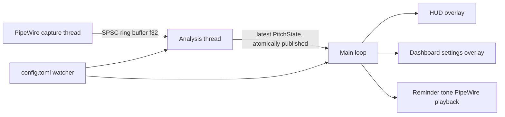

# frame-vocal-pitch — functional specification

A vocal pitch trainer that runs **on the Steam Frame headset itself** and shows, as a small
SteamVR overlay, whether the wearer's voice is inside their target pitch range.

This document is the only input for implementation. See [Clean-room rules](#clean-room-rules).

---

## 1. Goals and non-goals

### Goals
- Real-time detection of the speaking fundamental frequency (F0) from the Frame's microphone.
- A glanceable in-headset indicator: in range / too low / too high / no voice / mic muted.
- Settings reachable from inside VR (SteamVR dashboard tab); no PC or keyboard needed.
- Install from the Frame's terminal with one command; starts automatically with SteamVR if the user opts in.
- Low power: no rendering or GPU work while nothing visible changes or the headset is off the head.

### Non-goals (v1)
- Desktop/PC version, Windows support, streaming-mode (PC SteamVR) support.
- Teaching voice technique, recording sessions to disk, judging how a voice will be perceived.
  Resonance feedback exists only as the opt-in, experimental indicator of §5.1.
- Push-to-talk key emulation (there is no local voice-chat client to drive on the headset).
- Changing the Frame's **system-wide** audio setup: WirePlumber/PipeWire config files, the `filters`
  metadata, default devices, ALSA mixer.

---

## 2. Platform facts (Steam Frame, as of 2026-09/10)

| Item | Value |
|---|---|
| CPU / OS | Snapdragon 8 Gen 3, aarch64, SteamOS 0.5.x (Arch-based), kernel 6.18 |
| glibc | 2.39 |
| Audio | PipeWire (`libpipewire-0.3.so.0`, package 1.6.x) + WirePlumber; tools `wpctl`, `pw-dump`, `pw-cli`, `pw-play` present |
| Vulkan loader | `libvulkan.so.1`, 1.4.x |
| OpenVR runtime lib | `/opt/steamvr/bin/linuxarm64/libopenvr_api.so` (ships with SteamVR) |
| User services | `systemctl --user`; SteamVR runs as user unit `steamvr.service` |
| App launcher | SteamVR dashboard "+" list reads XDG `.desktop` files from `~/.local/share/applications` |
| Shell access | Developer Mode → Konsole on headset, or `ssh` (password set in Developer settings) |
| Steam language | `~/.steam/registry.vdf` |

Known hazards (must be respected):
- **Never restart PipeWire or WirePlumber** — SteamVR and Steam Link lose audio.
- **Never write ALSA mixer controls** — some controls default to 0 and silence the microphone.
- In Desktop Mode, `XDG_RUNTIME_DIR` may point at a nested-session directory where `systemctl --user`
  fails; install scripts must use `/run/user/$UID` for user-unit operations.
- `.desktop` `Exec=` must be an absolute path (Steam's PATH lacks `~/.local/bin`).
  Provide hicolor icons at 48, 128 and 256 px.
- OpenXR is not an option: SteamVR does not implement `XR_EXTX_overlay`. Use the OpenVR overlay API.

### Microphone signal path
Facts observed on the Frame:
- The default source is a Valve wrapper node,
  `alsa_loopback_device.alsa_input.platform-sound.HiFi__Mic__source` (`Audio/Source`). Its paired
  stream node (same `node.link-group`) has `target.object` = `alsa_input.platform-sound.HiFi__Mic__source`,
  the hardware mic node (2 channels: two digital mics).
- Between the hardware node and the wrapper sit Valve's processing stages: EQ + 2→1 downmix
  (`eq_*`), WebRTC echo cancellation with automatic gain control (`echo_cancel_*`), and noise
  suppression with a voice-activity gate (`ns_*`). Each is a WirePlumber **smart filter** (main node
  carries `filter.smart = true` and `steamos.mic_filter = true`).
- Smart filters are inserted by WirePlumber's linking policy **when WirePlumber links a stream** to the
  filtered target (WirePlumber docs, "Smart Filters"). Enable/disable is global, through the `filters`
  metadata key `filter.smart.disabled` — toggling it would change the mic for every app and game.
- Valve's mic tracker enables the filters while at least one `Stream/Input/Audio` node exists whose
  `node.virtual` is not `true`, and disables them when none remain. While disabled, the hardware node
  feeds the wrapper directly.
- The user's mic mute (`wpctl set-mute @DEFAULT_AUDIO_SOURCE@`) acts on the wrapper node, not on the
  hardware node.
- SteamOS hides the hardware mic node, the wrapper's loopback stream and every node with
  `steamos.mic_filter = true` from applications on the normal `pipewire-0` socket
  (`/etc/wireplumber/wireplumber.conf.d/10-access.conf`, permission manager `steamos-default`:
  empty permissions on those nodes). Such clients see only the wrapper source; they cannot resolve
  or link the hardware node. Tools on `pipewire-0-manager` (`wpctl`, `pw-dump`, `pw-link`) see
  everything, which is why the topology above is visible from a shell but not from an app.

Consequences for pitch tracking: amplitude is unreliable (AGC), quiet onsets may be gated to silence
(noise suppression), echo cancellation can attenuate the voice. The app nevertheless records the
processed default source (§6.3): reading the hardware node would require sidestepping Valve's access
policy, which the app deliberately does not do. Pitch detection is robust to these stages; the
resonance indicator (§5.1) is less accurate on processed audio.

---

## 3. Architecture

Single Rust binary `frame-vocal-pitch`, target `aarch64-unknown-linux-gnu`, one process, four roles:



- **Capture thread**: PipeWire thread loop; owns the capture stream (§6.3). The process callback only
  copies samples (downmixed to mono by averaging channels) into a lock-free
  single-producer/single-consumer ring buffer (no allocation, no locks, no logging).
- **Analysis thread**: pulls hops from the ring buffer, runs pitch detection (§5), publishes the latest
  `PitchState` (F0 Hz or none, voicing confidence, classification, timestamp) via an atomic/seqlock.
- **Main loop**: one `poll()`-style wait whose timeout is the nearest deadline (render tick, OpenVR
  event poll, config watch, retry timers). Owns all OpenVR and Vulkan objects.
- **Reminder tone**: short PipeWire playback stream created on demand, destroyed when idle.

Crates (suggested, not mandatory): `ash` (Vulkan), `pipewire` (capture/playback), `realfft`
(FFT-based YIN), `tiny-skia` (2D raster), `fontdue` or `ab_glyph` (text), `serde` + `toml` (config),
`libloading` (OpenVR), `bindgen` at build time or hand-written FFI for `openvr_capi.h`.

### 3.1 OpenVR binding
- Load `libopenvr_api.so` at runtime with `dlopen`, path from §2; allow override via env
  `FVP_OPENVR_LIB`. Do not bundle the library.
- Bindings generated from `headers/openvr_capi.h` of the OpenVR SDK v2.15.6 (BSD-3-Clause; keep its
  notice in `THIRD_PARTY_LICENSES.md`). Interface tables are obtained with `VR_GetGenericInterface`
  using the `FnTable:` prefix on the interface version strings.
- Startup: first `VR_InitInternal2` as `VRApplication_Background` to test whether SteamVR is running
  without launching it. `VRInitError_Init_NoServerForBackgroundApp` ⇒ not running ⇒ retry every 3 s.
  When it succeeds, shut down and re-init as `VRApplication_Overlay`.
- Handle `VREvent_Quit` by acknowledging (`AcknowledgeQuit_Exiting`) and tearing down cleanly, then
  return to the retry state (the process keeps running; SteamVR may restart).
- Shutdown order: clear overlay textures → destroy overlays → wait ~400 ms → `VR_ShutdownInternal`
  → destroy Vulkan objects.

### 3.2 Texture submission
- Own `VkInstance`/`VkDevice` created with the extensions OpenVR requests
  (`IVRCompositor::GetVulkanInstanceExtensionsRequired`, `GetVulkanDeviceExtensionsRequired`) and the
  physical device returned by `IVRSystem::GetOutputDevice(TextureType_Vulkan, instance)`.
- Upload CPU-rendered RGBA8 pixels to a `VkImage` through a staging buffer; keep **two** images per
  overlay and alternate; submit with `IVROverlay::SetOverlayTexture` (`TextureType_Vulkan`,
  `ColorSpace_Gamma`, `VRVulkanTextureData_t`).
- Do **not** use `SetOverlayRaw` (observed flicker on swap and crashes at exit on the Frame).
- If the renderer outputs premultiplied alpha, set `VROverlayFlags_IsPremultiplied`.
- Upload only when the pixels changed.

---

## 4. Overlays and UI

### 4.1 HUD overlay (key `codeyumx.frame-vocal-pitch.hud`)
A small panel attached to a tracked device via `SetOverlayTransformTrackedDeviceRelative`.

Placement: relative to the HMD, default offset x = −0.12 m, y = −0.10 m, z = −0.6 m, facing the eye
(the only placement; wrist placements were removed after 0.3.0 because they did not work on the
Frame, and an old `hud.placement` key is ignored).

Content (setting `display`):
- `color` (default): a rounded tile filled with the state colour.
- `detailed`: the tile plus a vertical range bar (detection span, target band highlighted, marker at
  current F0) and the current F0 as text (`182 Hz`), or `—` when unvoiced. When resonance feedback
  (§5.1) is on, a second thin bar to the right of the range bar shows the brightness marker; it never
  changes the tile colour. In `color` mode resonance is not shown.

States and default colours:

| State | Condition | Colour |
|---|---|---|
| `in_range` | voiced, F0 within target band | green `#2EBD59` |
| `too_low` | voiced, out of range below the band by at most `target.near_hz`: raise the voice | yellow `#F2C94C`, dark glyphs |
| `too_high` | voiced, out of range above the band by at most `target.near_hz`: lower the voice | orange `#F07F2E`, dark glyphs |
| `out_of_range` | voiced, further than `target.near_hz` outside the band (either side), or any out-of-range voice when `near_hz = 0` | red `#D9433B` |
| `no_voice` | unvoiced / silence | dark grey `#202020`, 60 % alpha |
| `muted` | default source muted (`wpctl get-volume @DEFAULT_AUDIO_SOURCE@` reports `[MUTED]`, polled every 2 s); input is discarded while muted | grey with a crossed-mic glyph |
| `no_mic` | capture stream failed or no buffers for 3 s | blue `#3D7DD8` with `!` |

`too_low` / `too_high` / `out_of_range` split the tracker's single `out_of_range` class (§5). The side
is decided by the band's geometric centre √(low·high), because the ±2 Hz hysteresis can keep
`out_of_range` slightly inside an edge (that counts as near). Without an F0 the previous state is
kept. The reminder tone (§5) keys on the tracker class, so the colours give direction without a tone.

Colour transitions animate over 300 ms (configurable `fade_ms`, 0 disables). Animate only while a
transition is in progress; otherwise render nothing new.

Size: `size_m` default 0.05 m width; opacity `opacity` default 0.9. Sort order above normal overlays.

Visibility: show the HUD only when `enabled = true` **and** the HMD is being worn
(`GetTrackedDeviceActivityLevel(HMD) == k_EDeviceActivityLevel_UserInteraction`). While hidden: stop
rendering; analysis keeps running only if needed for the vocal-rest timer.

### 4.2 Dashboard settings overlay (key `codeyumx.frame-vocal-pitch.settings`)
Created with `CreateDashboardOverlay` (title "Vocal Pitch", 256 px icon). Mouse input via
`VROverlayInputMethod_Mouse` with `SetOverlayMouseScale` = panel pixel size; enable
`SendVRSmoothScrollEvents`. Render only while the dashboard is visible and this tab is active.
Panel 1200 × 800 px at ~2.8 m width. Set `VROverlayFlags_EnableControlBarClose` on the dashboard
overlay so its control bar shows a close (×) button; the resulting `VREvent_OverlayClosed` for this
overlay is handled exactly like the Quit button (clean shutdown, exit status 3). The process must never
keep running after its tab was closed.

Controls (each writes the config file immediately):
- HUD on/off; display mode; size; opacity; position nudges (up/down/left/right/closer/further).
- Target preset: `feminine` (165–255 Hz), `masculine` (85–180 Hz), `custom`.
- Custom range: low/high with ±1 Hz and ±10 Hz steppers; low < high enforced, ≥ 10 Hz gap.
- Yellow/orange zone (`target.near_hz`): stepper ±1/±5 Hz, 0–50, "Off" at 0; applies to every preset.
- Live strip: current F0 and state (so the user can test settings while speaking).
- Reminder tone: on/off, delay (0.5–10 s), pitch (100–1000 Hz), volume (0–100 %).
- Vocal rest: off or 5–50 min of voiced time per rolling 60 min.
- Autostart with SteamVR on/off (enables/disables the user unit).
- Updates (§7.1): current version, status line ("Up to date · checked 2 h ago", "Version X.Y.Z is
  available", "Checking…", "Updating to X.Y.Z…", "Update failed: <reason>", "Couldn't check: <reason>"),
  buttons "Check now" and, only when a newer release exists, "Update to X.Y.Z" (asks for a second
  click "Confirm update" within 10 s, so a stray click cannot start it). Toggle "Check automatically".
- Status line under "Microphone & startup" (§6.3): the source recorded from, mute, and the current
  capture problem if any.
- Quit (exits with status 3 so the service does not restart it). Label "Quit" plus a one-line hint
  under it: "Stops the app until SteamVR starts again" when autostart is on, "Stops the app" otherwise.
- Resonance (experimental), §5.1: off by default. Turning it on first shows the explanation card
  (§5.1 "User guidance") with "Turn on" / "Keep off". When on: the current reading in Hz, "Relaxed"
  and "Target" reference values with ±10/±50 Hz steppers, the current position as text, and a
  "How this works" button that re-opens the card.

Text strings live in one table; English required, layout must tolerate 30 % longer strings.

---

## 5. Pitch detection

Algorithm: **YIN** (A. de Cheveigné, H. Kawahara, "YIN, a fundamental frequency estimator for speech
and music", JASA 111(4), 2002), implemented from the paper.

Parameters (defaults; all constants in one module):

| Parameter | Value |
|---|---|
| Sample rate | 48 000 Hz mono (downsample 3:1 to 16 000 Hz with a proper low-pass first is allowed and preferred for power) |
| Detection span | 60–500 Hz (`detect_min_hz`, `detect_max_hz`) |
| Integration window W | ≥ 2 × the longest period (≥ 33 ms) |
| Hop | 10 ms |
| Difference function | computed via FFT autocorrelation (O(N log N)), not the direct O(N²) sum |
| Absolute threshold | 0.12 on the cumulative-mean-normalised difference |
| Refinement | parabolic interpolation around the chosen lag |
| Voicing | voiced iff YIN dip value ≤ 0.25 **and** frame RMS above an adaptive noise floor (EMA of unvoiced-frame RMS × 3; floor clamp configurable) |

Post-processing:
- Median of the last 5 voiced estimates; reset on 100 ms of unvoiced frames.
- Octave-jump guard: a new estimate ≈ 2× or ≈ 0.5× (±6 %) the running median is accepted only after
  it persists for 3 consecutive hops.
- Classification hysteresis: switching between `in_range` and `out_of_range` requires the new state
  for ≥ 120 ms; band edges get ±2 Hz hysteresis.
- Unvoiced → `no_voice` after 150 ms of continuous unvoiced frames.

Reminder tone: when state has been `out_of_range` continuously for `reminder_delay_s`, play a sine
tone (20 ms fade in/out) for 300 ms, then at most once every 2 s while still out of range.

Vocal rest: accumulate voiced time in 1-second buckets over a rolling 60-minute window; when the sum
exceeds the threshold, show a toast on the HUD ("Vocal rest: X min voiced in the last hour") and
repeat at most every 10 minutes.

Acceptance (unit tests on synthetic 48 kHz signals):
- Pure sines 70, 100, 150, 220, 330, 450 Hz → within ±1 % after 100 ms.
- Harmonic-rich tones (sawtooth; and a tone whose 2nd harmonic is 2× the fundamental's amplitude)
  at 110 and 200 Hz → fundamental, not the harmonic.
- White noise at −20 dBFS and digital silence → unvoiced.
- Glide 120 → 260 Hz over 2 s → monotonic estimates, no octave errors.
- Real voice: `--analyze file.wav` CLI (§8) prints a time/F0 table for manual checking.
- CPU budget: analysis < 2 % of one core on the Frame (measure with `--bench`).

### 5.1 Resonance feedback (experimental, opt-in)
Purpose: show whether the user's voice is drifting **darker or brighter relative to two reference
values the user sets** from their own voice. It is not a verdict on how the voice sounds to others,
has no "in range" state, never changes the tile colour and never triggers the reminder tone.

Measurement (on the 16 kHz signal the pitch path already produces):
- Frames of 25 ms every 10 ms, only on hops the pitch path marks voiced with F0 ≤ 300 Hz (above that,
  harmonics are too sparse for reliable formant estimates; such hops are skipped).
- Pre-emphasis 0.97, Hamming window, linear prediction (autocorrelation method, Levinson–Durbin),
  order 16. Formants F1–F3 = the three lowest resonances of the LPC model between 200 and 4000 Hz with
  bandwidth < 500 Hz, found by polynomial roots or by peak-picking the LPC envelope on a ≤ 10 Hz grid.
  Frames without three valid formants are skipped.
- Per-frame metric: formant spacing ΔF from the uniform-tube model Fi = (2i − 1)·ΔF/2, least-squares
  over i = 1..3: ΔF = Σ Fi·(2i−1)/2 ÷ Σ ((2i−1)/2)². Higher ΔF = brighter.
- Displayed value R = median ΔF over the voiced frames of the last 8 s (`resonance.window_s`).
  Needs ≥ 2 s of accepted frames in the window; otherwise state "gathering" (marker hidden, bar dim).
- Runs on the processed default source (§6.3). Valve's EQ, noise suppression and AGC colour the
  spectrum, so readings are rougher than on a raw signal.

Reference values (replaced the 10 s calibration recordings after 0.3.0):
- `resonance.relaxed_df_hz` and `resonance.target_df_hz`, numbers in Hz (defaults 1000 / 1150, range
  500–2000), set with steppers on the resonance page. The page shows the current smoothed reading R
  ("Current reading: 1043 Hz", "—" while gathering) so the user can speak in each voice and copy the
  reading into the matching value.
- If |target − relaxed| < 5 % of relaxed: show "The relaxed and target values are too close to tell
  apart" and keep the marker hidden.
- Position p = (R − relaxed) / (target − relaxed), shown clamped to −0.25…1.25 on the bar with ticks
  at 0 ("relaxed") and 1 ("target"). Text: "Brightness: near relaxed / between / near target /
  beyond target". Changes in p are smoothed (EMA, 1 s time constant); the marker moves slowly by design.

User guidance (the explanation card; text in the string table, plain language, ≤ 120 words visible
without scrolling, rest scrollable):
- What it is: an estimate of how bright or dark your voice sounds, compared with two reference
  values set from your own voice. It moves slowly and is rough.
- When it may not help — **turn it off if any of these apply or if it does not match what you hear
  or what people you trust tell you**:
  - You speak a different language or accent in VR than when you set the values, or switch often
    (vowels differ between languages and accents, and they move the estimate). Set them again in the
    language you are using.
  - Whispering, singing, shouting, very high pitch (above ~300 Hz it cannot measure), or a noisy room.
  - Your goal is not about how bright or dark your voice sounds.
  - Watching it makes you tense or self-conscious.
- It cannot tell you how others perceive your voice. A voice coach or a trusted listener can.
- Pitch feedback works the same with the indicator on or off.

Acceptance (unit tests, synthetic source–filter vowels: glottal pulse train at F0 100/150/220 Hz through
three second-order formant resonators, 48 kHz input):
- Vowels /a/ (≈ 700/1200/2600 Hz), /i/ (≈ 300/2300/3000), /u/ (≈ 300/800/2300) with all formants scaled
  ×1.00 and ×1.15: R averaged over a 3-vowel mix rises by 15 % ± 4 %.
- Per-vowel formant estimates within ±8 % of the resonator frequencies at F0 100 and 150 Hz. At
  F0 220 Hz only F3 (and /a/'s F1–F3) must be within ±8 %; low F1/F2 of /i/ and /u/ are biased toward
  the harmonics (known limitation of autocorrelation LPC at high F0) — the test records the measured
  deviation instead of asserting it. The R scaling test above is the binding requirement at all F0s.
- F0 = 350 Hz input, noise and silence → no accepted frames.
- Reference values: < 5 % apart → "too similar" state; p = 0 at relaxed, 1 at target, clamped display.
- CPU: pitch + resonance together < 3 % of one core on the Frame (`--bench` prints both).

---

## 6. Configuration and runtime

### 6.1 Config file
`$XDG_CONFIG_HOME/frame-vocal-pitch/config.toml` (default `~/.config/...`), mode 0600.
- Missing → write defaults. Unparseable → rename to `config.toml.bad`, write defaults, log once.
- Save via write-to-temp + `rename`.
- Watch for external edits (stat poll at 2 Hz); apply changes live.
- Every key has a default; unknown keys preserved is not required.

Schema (all keys optional; missing → default; out-of-range numbers are clamped on load; unknown enum
strings → default and a log line):

| Table.key | Type | Default | Range / values |
|---|---|---|---|
| `hud.enabled` | bool | `true` | |
| `hud.display` | string | `"color"` | `color`, `detailed` |
| `hud.size_m` | float | 0.05 | 0.02–0.20 |
| `hud.opacity` | float | 0.9 | 0.1–1.0 |
| `hud.nudge_x_m`, `hud.nudge_y_m`, `hud.nudge_z_m` | float | 0.0 | ±0.5; added to the built-in offset; dashboard step 0.01 m |
| `hud.fade_ms` | int | 300 | 0–2000 |
| `target.preset` | string | `"feminine"` | `feminine`, `masculine`, `custom` |
| `target.custom_low_hz`, `target.custom_high_hz` | float | 165, 255 | within detection span; low ≤ high − 10 |
| `target.near_hz` | float | 10 | 0–50; yellow/orange zone width outside the band (§4.1), 0 = off; dashboard steps ±1/±5 |
| `reminder.enabled` | bool | `false` | |
| `reminder.delay_s` | float | 2.0 | 0.5–10 |
| `reminder.pitch_hz` | float | 440 | 100–1000 |
| `reminder.volume` | float | 0.5 | 0–1 |
| `vocal_rest.minutes` | int | 0 | 0 = off, else 5–50 |
| `audio.detect_min_hz`, `audio.detect_max_hz` | float | 60, 500 | 40–1000, min ≤ max − 50 |
| `audio.noise_floor_min_dbfs` | float | −60 | −90 to −20; lower clamp of the adaptive noise floor (§5) |
| `resonance.enabled` | bool | `false` | §5.1; set only after the explanation card was acknowledged |
| `resonance.window_s` | float | 8 | 4–20 |
| `resonance.relaxed_df_hz`, `resonance.target_df_hz` | float | 1000, 1150 | 500–2000; reference values (§5.1) |
| `update.check` | bool | `true` | automatic update checks (§7.1); "Check now" and "Update" work either way |

`audio.mic_mode` (versions ≤ 0.3.0) is no longer read; files containing it load normally and the
key disappears on the next save.

Autostart is not a config key: it is the enabled state of the systemd user unit (§7).

### 6.2 Process lifecycle
- Single instance: `flock` on `$XDG_RUNTIME_DIR/frame-vocal-pitch.lock` containing the PID.
  A second launch sends `SIGUSR1` to the running instance (toggles HUD and opens the dashboard tab)
  and exits 0.
- `SIGTERM`/`SIGINT`: clean shutdown (§3.1 order). `SIGUSR1`: toggle.
- Exit status 3 = user chose Quit or closed the dashboard tab (service must not restart, and systemd
  must record it as a normal stop, not a failure).
- Logs to stderr (journald via the unit); `--verbose` raises level.

### 6.3 Mic input
The app never writes WirePlumber/PipeWire configuration or metadata and connects on the normal
`pipewire-0` socket like any other application.

One capture stream `node.name = frame-vocal-pitch-capture`, `PW_STREAM_FLAG_AUTOCONNECT`, no target,
F32 48 kHz with the channel layout left to the graph (downmixed to mono in the process callback).
WirePlumber links it to the default source, through Valve's smart filters when they are active; the
mic tracker counts it as mic use (§2).

- **Registry.** Node labels come from global properties (`node.name`, `node.description`,
  `node.nick`); nodes are not bound. The `default` metadata is bound for `default.audio.source`,
  whose node's label is the status line's source.
- **Errors.** Only a core error with `id = 0` and `res = -EPIPE` means the connection is gone (drop
  everything, reconnect after 2 s). Every other core error concerns a single object — e.g. `-ENOENT
  "unknown resource N op:M"` when a proxy is destroyed after its global went away — and is logged at
  debug level only. Treating those as disconnects recreated the stream in a loop on the Frame.
- **Stream failure.** A stream error or unexpected disconnect drops the stream and recreates it after
  2 s; the status line shows the reason meanwhile.
- **Mute.** Honour the user's mute on the default source (state `muted`, input discarded).

Status line: "Recording from <source>", then "mic muted" and the current problem when present.

On-device verification (required before release):
- `pw-link -l` shows the wrapper source's ports linked to `frame-vocal-pitch-capture`.
- Pressing the volume buttons while the app runs moves the volume in normal steps; the app's log
  shows no reconnects.
- Toggling mute and changing the default source are reflected within 2 s.

### 6.4 CLI
```
frame-vocal-pitch                 run (normal mode)
frame-vocal-pitch --version       prints "frame-vocal-pitch <semver>"
frame-vocal-pitch --verbose
frame-vocal-pitch --probe         print environment: SteamVR running?, OpenVR lib found?,
                                  default source and its mute state; exit
frame-vocal-pitch --analyze F.wav print time, F0, state per hop for a WAV file; exit
frame-vocal-pitch --bench         run analysis on synthetic audio, print µs/hop; exit
frame-vocal-pitch --render-png DIR
                                  render HUD (every state, both display modes) and settings panel
                                  to PNGs with fake data; exit. Must work without SteamVR/GPU.
```

---

## 7. Install, update, uninstall

Release artefacts per GitHub release (tag `vX.Y.Z`):
- `frame-vocal-pitch-X.Y.Z-aarch64.tar.gz` containing one top-level folder
  `frame-vocal-pitch-X.Y.Z/` with: `frame-vocal-pitch` binary, `install.sh`, `frame-vocal-pitch.service`,
  `frame-vocal-pitch.desktop`, `icons/{48,128,256}.png`, `LICENSE`, `THIRD_PARTY_LICENSES.md`, `README.md`.
- `SHA256SUMS` (`<sha256>  <filename>` lines).

One-line install (documented in README):
```
curl -fsSL https://github.com/codeyumx/frame-vocal-pitch/releases/latest/download/install.sh | bash
```
`install.sh` behaviour:
- Refuse to run as root; refuse if `uname -m` ≠ `aarch64`; warn if `/etc/os-release` `ID` ≠ `steamos`.
- When piped (not run from an extracted release): resolve the latest release, download the tarball and
  `SHA256SUMS`, verify the checksum, extract to a temp dir, re-run itself from there.
- Install only under `$HOME`: binary → `~/.local/bin/`, unit → `~/.config/systemd/user/`,
  `.desktop` (with absolute `Exec=`) → `~/.local/share/applications/`, icons → `~/.local/share/icons/hicolor/<n>x<n>/apps/`.
- Idempotent: re-running updates in place; if the service is active, restart it; otherwise stop a
  manually started instance via the PID in the lock file.
- Options: `--autostart` / `--no-autostart` (enable/disable unit), `--uninstall` (remove everything
  except config), `--uninstall --purge` (also config), `--version` (print version of the payload),
  `--release vX.Y.Z` (piped/lone-file mode only: download that tag instead of the latest; refuse if
  the tag or its `SHA256SUMS` is missing).
- Record chosen options in `~/.config/frame-vocal-pitch/install-args` so updates keep them
  (`--release` is never recorded).
- Also install a copy of itself as the updater, `~/.local/share/frame-vocal-pitch/install.sh` (mode
  0755); `--uninstall` removes `~/.local/share/frame-vocal-pitch/` and `~/.cache/frame-vocal-pitch/`.
- Use `XDG_RUNTIME_DIR=/run/user/$(id -u)` for `systemctl --user` calls (Desktop Mode fix).

systemd user unit:
```
[Unit]
Description=Vocal pitch overlay for SteamVR
After=steamvr.service
PartOf=steamvr.service
[Service]
ExecStart=%h/.local/bin/frame-vocal-pitch
Restart=always
RestartSec=5
RestartPreventExitStatus=3
SuccessExitStatus=3
[Install]
WantedBy=steamvr.service
```

### 7.1 Self-update
Modelled on the user experience of other Frame tools: check quietly, install only after the user
confirms, never leave a broken install.

Check:
- The app asks GitHub `https://api.github.com/repos/codeyumx/frame-vocal-pitch/releases/latest` for
  `tag_name` (use `curl -fsSL --max-time 15` as a child process on a helper thread; no TLS library in
  the binary; never block the main loop). Ignore drafts/prereleases (the endpoint already does).
- Newer = semantic-version comparison of `tag_name` (leading `v` stripped) against the running version.
- Automatic checks (`update.check = true`): at start and every hour, but hit the network at most once
  per 24 h; after a failed check retry after 1 h. Cache `{checked_at, latest, error}` in
  `~/.cache/frame-vocal-pitch/update-check.json`. "Check now" ignores the cache.
- Never notify on the HUD; the dashboard Updates section is the only place updates appear.

Install (only after "Update to X.Y.Z" + "Confirm update"):
- Run the updater in a transient systemd user unit so it survives the service restart:
  `systemd-run --user --unit=frame-vocal-pitch-update --collect --property=StandardOutput=append:<log>
  --property=StandardError=append:<log> /bin/bash ~/.local/share/frame-vocal-pitch/install.sh
  --release vX.Y.Z` with `<log>` = `~/.cache/frame-vocal-pitch/update.log` (truncate it first),
  `XDG_RUNTIME_DIR=/run/user/<uid>`. If the unit name is already active, show "An update is already
  running".
- The installer downloads that exact tag, verifies `SHA256SUMS`, re-runs the release's own
  `install.sh` with the recorded install-args, and restarts the service, which ends the old process.
  If the app was started by hand (no active service), the installer stops it via the lock-file PID;
  the app then shows nothing more, so before starting the update it shows "Updating… the app will close;
  start it again from the + list" in that case.
- Failure: the installer must not touch the installed files before the download is verified; any
  failure leaves the current version installed and running. The app polls the unit
  (`systemctl --user show frame-vocal-pitch-update -p ActiveState -p Result`) every 2 s while updating
  and shows "Update failed: <last non-empty line of update.log>" if it ends without the process being
  replaced.
- Security note for the README: `SHA256SUMS` comes from the same release, so this catches broken
  downloads, not a replaced release; it is a checksum, not a signature.
- Versions up to 0.2.1 have no updater: update once by re-running the install command.

Acceptance:
- Unit tests: version comparison (`v0.10.0 > v0.9.9`, equal, malformed tag → "Couldn't check"), cache
  rules (24 h, 1 h after failure, Check now bypass, `update.check = false` disables only automatic
  checks), the two-step confirm with its 10 s timeout, status-line texts.
- `scripts/test-install.sh` extended: `--release` with a fake download URL installs that version,
  a checksum mismatch or missing tag changes nothing, the updater copy is installed, and `--uninstall`
  removes it and the cache dir.
- Host smoke: with `curl` against the real GitHub API the app reports the current latest release.

---

## 8. Build, test, CI

- Toolchain: stable Rust, edition 2021, `#![deny(unsafe_op_in_unsafe_fn)]`; all `unsafe` confined to
  the OpenVR, Vulkan and PipeWire modules.
- Local cross-build: `build/build-aarch64.sh --release` (Ubuntu 24.04 container, arm64 multiarch
  libraries, glibc 2.39 baseline). Host-side unit tests: `cargo test` on x86_64 (pitch, config,
  state machine, rendering to PNG do not need the headset).
- Run aarch64 tests under emulation: `docker run --platform linux/arm64 ubuntu:24.04` with the built
  test binary (QEMU binfmt registered on the dev machine).
- CI (GitHub Actions, `ubuntu-latest`): build the same container, `cargo test` (x86_64),
  cross-build aarch64 release, package tarball + `SHA256SUMS`, attach to the release on tag push.
- On-device checks (manual, via ssh): `--probe`, `--analyze` of a recording made on the Frame with
  `pw-record`, HUD placement and nudges, dashboard tab, autostart across SteamVR restart, uninstall.

---

## 9. Licensing
- Project license: Apache-2.0 (`LICENSE`).
- `THIRD_PARTY_LICENSES.md`: OpenVR SDK header (BSD-3-Clause notice), every bundled font (SIL OFL 1.1
  text), Rust crate licenses (generate with `cargo about` or equivalent), and a note that
  `libopenvr_api.so`, `libpipewire-0.3.so.0` and `libvulkan.so.1` are loaded from the system, not shipped.
- No code, assets, sounds or images from other projects.

---

## Clean-room rules
1. Implementers work **only** from this document and public primary sources: the OpenVR SDK
   (headers, wiki), PipeWire documentation, the Vulkan specification, the YIN paper, crate docs.
2. Implementers do **not** open anything under `references/`, nor PitchBrick or the
   sasaken1102r repositories online.
3. Questions that this spec does not answer go back to the spec author, who answers with
   facts/requirements (amending this file), never with code.
4. The spec author does not write implementation code; they may review behaviour and test results.
